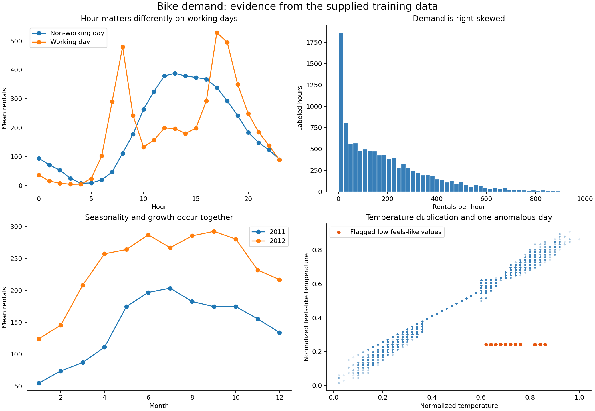

# Bike-demand data analysis and modeling roadmap

Analyzed on October 1, 2026. Sources: the supplied project brief, the local
`data/raw` files, and the current repository. This is exploratory analysis,
not the final notebook or the assignment's six-page report.

## Recommendation and evidence

The strongest candidate is a regularized linear model over a carefully chosen
nonlinear feature basis: categorical hour/calendar/weather effects, hour by
working-day interactions, temperature/humidity/wind products, and hour-specific
calendar, growth, and weather effects. Feature representation is the main
opportunity; ordinary numeric encoding severely underfits this dataset.

I ran seven feature designs using from-scratch full-batch gradient descent on
one chronological split. Earlier dates end August 5, 2012; validation starts
August 6, 2012. This whole-day boundary gives 8,727 training and 2,159 validation
hours. Scales, column availability, and fitted weights use earlier data only.
No random split was invented: `TEAM_IDS` is empty, so official team-seeded
validation results cannot yet be produced. The hidden test was inspected only
for structure and alignment and was not used to select models.

| Feature design | Features | Train R2 | Chronological R2 | Chronological RMSE |
|---|---:|---:|---:|---:|
| Raw numeric calendar and weather | 12 | 0.3964 | 0.2860 | 184.19 |
| Categorical hour, month, weekday, season, weather | 53 | 0.6943 | 0.6382 | 131.11 |
| Above plus hour by working day | 76 | 0.8276 | 0.7978 | 98.03 |
| Targeted degree-2/3 weather/calendar products | 203 | 0.9088 | 0.8924 | 71.49 |
| Above without feels-like temperature | 202 | 0.9086 | 0.8938 | 71.03 |
| Structured design without elapsed-day trend, retaining feels-like | 202 | 0.9087 | 0.8921 | 71.61 |
| Extended hour-specific season, weather, weekday and wind, without feels-like | 478 | 0.9309 | 0.9195 | 61.84 |

The simple and extended designs are candidates, not proof of a globally best
model. The extended design was assessed on the same chronological holdout as
the other designs; this is model development, not an independent final test.
The score does not predict the unknown hidden-test score. No Ridge/Lasso/
Elastic Net winner or Phase 5 score has been measured yet.

The 203- and 478-feature designs reach the 100,000-iteration limit before the
strict maximum-gradient tolerance of 1e-5. Their maximum gradients are about
0.000247 and 0.000208 respectively. As an optimizer check, an independent
NumPy least-squares solution on the identical training matrix gives essentially
the same R2; prediction differences on chronological validation have RMSE
0.0275 and 0.0268 bikes. The reference optimizer is not used for warm starts,
training artifacts, or model selection. The 202-feature no-atemp model meets
the actual stopping tolerance in 81,379 iterations. Regularization and less
redundant feature coding should improve numerical conditioning.

Run `python analysis/analyze_data.py` to reproduce the analysis. Full precision
scores, learning rates, iterations, gradient checks, and numerical comparisons
are in `outputs/analysis/chronological_feature_ablation.csv`.

## What the data says

- **Size and integrity:** 10,886 labeled rows, 574 hidden rows; 14 predictors
  including the identifier/date, and one labeled target. Neither file has null
  cells. Training has no duplicate rows or duplicate date/hour pairs, and no
  IDs overlap with test. Submission IDs match test IDs in order. The zero
  counts in the sample submission are placeholders, not labels.
- **An unusual sampling pattern:** labeled dates are days 1-19 of every month
  in 2011-2012. Hidden dates are day 20 of each month. Test is not simply the
  future after the last labeled date; it is distributed across the two years.
  Day-of-month is consequently a modest extrapolation, and should not be
  expanded into a high-degree polynomial or memorized with date IDs.
- **Missing hours:** the 456 labeled calendar days would contain 10,944 rows
  at 24 hours/day, leaving 58 absent hours. These are different from the
  intentionally withheld dates. There are no zero-rental rows. Missing hours
  must not be silently labeled as zero. A row shift does not necessarily mean
  one hour ago; date/time gaps and prediction-time availability must be checked
  before attempting lag features.
- **Demand is skewed:** mean 191.57, median 145, 75th percentile 284, 95th
  percentile 563.75, maximum 977. Large peaks are real predictive targets, not
  automatically outliers. The assignment scores raw-count R2 and RMSE; a log
  target is only useful if predictions converted back to counts improve these
  metrics. Optimizing a log-scale metric alone changes the objective.
- **Hour by working day dominates:** working-day mean demand is 479.9 at
  08:00, 529.2 at 17:00, and 495.5 at 18:00. Non-working-day demand peaks
  around midday: 387.8 at 13:00. At 03:00, working-day mean is only 4.9.
  `workingday` has marginal correlation only 0.012 with demand despite its
  decisive interaction with hour. Do not select features by correlation alone.
- **Growth:** mean demand is 144.22 in 2011 versus 238.56 in 2012, a 65.4%
  increase. Month profiles also differ by year. Encode year and test growth
  interactions; a static seasonal curve cannot represent everything.
- **Weather:** clear-weather mean demand is 205.24; weather category 3 has
  mean 118.85. These are observational averages, not isolated causal weather
  effects. Category 4 has only one labeled observation, so its coefficient
  requires strong shrinkage or justified grouping; do not give it many
  unregularized interactions.
- **Redundant temperature measurements:** `temp` and `atemp` correlate at
  0.98495. On August 17, 2012, all 24 `atemp` values equal 0.2424 while `temp`
  takes 11 values from 0.62 to 0.86. This is suspicious, not a confirmed
  sensor failure. Keep a flag, compare with/without `atemp`, and avoid
  deleting a whole high-demand day. Dropping `atemp` slightly improved the
  measured chronological result, but needs confirmation on the team split.
- **Other operational flags:** humidity is zero in all 22 recorded hours on
  March 10, 2011; this deserves a sensitivity experiment. Wind speed is zero
  in 1,313 rows (12.1%). Zero wind can be legitimate, so do not automatically
  replace every zero with an imputed value. If imputation is tested, fit it
  only on training data and preserve missing/anomaly indicators.
- **Deterministic calendar overlap:** `workingday` exactly equals weekday
  Monday-Friday and non-holiday, with zero mismatches. Date-derived weekday
  exactly agrees with the supplied weekday. This makes some information
  redundant, but useful interaction terms can still rely on those columns.

The diagnostic holdout is harder in a particular way: training mean is 174.60
and validation mean is 260.20. The original structured model still
under-predicts peak hours: mean error is -87.4 rentals at 17:00 and -44.6 at
08:00. Those residuals refer to the 203-feature model, not the later extended
design. They motivate hour-specific seasonal/weather effects, which improved
the measured result. The small train/holdout gap for the extended design is
encouraging, but one seasonal holdout cannot establish universal robustness.

## How to approach the five phases

### Phase 1: establish a trustworthy linear baseline

Use the registered team IDs to calculate the SHA-256 seed and make exactly
the prescribed 80/20 split. Retain that split through all official phases.
Keep `instant` for submission alignment; use transformed date information for
model inputs. Start with one-hot hour, weather/calendar encodings, year,
weather measurements and an explicitly justified annual representation.
Compare hour dummies with cyclic hour: a single sine/cosine pair is smooth
but cannot closely describe two commute spikes. Calendar encoding itself is
a modeling decision; make the baseline feature manifest explicit.

Fit standardization on the training portion, add an intercept, and implement
MSE gradient descent. With loss `||Xw-y||^2/(2n)`, the gradient is
`X.T @ (Xw-y)/n`. Report learning-rate comparisons, finite/monotonic loss
behavior, iterations, gradient tolerance, train R2, validation R2 and RMSE.
An iteration cap alone is not evidence of convergence. Save the weights,
feature names/order, fitted transformations, and optimizer settings.

### Phase 2: represent the demand mechanism

Reuse exactly the Phase 1 optimizer. Preserve Phase 1 features and weights,
and initialize newly introduced coefficients to zero. If scaling changes,
convert coefficients through original feature units and adjust the intercept;
do not copy weights into incompatible column positions. Check that the
initialized expanded model makes the same predictions as Phase 1.

Test degree 2 first: hour by working day; weather squares and products;
hour by temperature/humidity/year; hour by categorical season/weather/weekday.
Selective degree 3 can represent hour by working day by temperature/year.
The exploratory simple structured design has maximum degree 3, not just
quadratic terms. Compare limited degrees 1, 2, and 3 with an explicit allowed
term list rather than blindly expanding every column. Full hour-dummy products
and powers waste columns because dummies are binary and mutually exclusive.

### Phase 3: diagnose model error and temporal robustness

Anchor the complexity sweep to Phase 2's design. Plot train and official
validation R2/RMSE against both degree and actual feature count. A high-degree
model that has not converged cannot fairly be labeled overfitted from its
score alone. Track optimizer convergence alongside predictive scores.

Use the one additional chronological split requested by the brief and fit
its preprocessing from scratch on its earlier portion. Keep a whole-day
boundary. Compare it with the required random estimate: random validation
mixes hours from the same days and can be optimistic for genuinely future
periods. The chronological score addresses future deployment, while the
hidden test's interleaved day-20 sampling differs from pure forecasting.
Explain both contexts instead of assuming one score describes every use.
Export a diagnosis and target feature complexity for Phase 4.

### Phase 4: stabilize the model and select features

Compare all three methods on the same Phase 3 feature matrix, split,
standardization, and convergence checks. The leading design is a candidate
for Ridge because it includes correlated calendar/weather/product terms;
Elastic Net is a candidate when coefficient sparsity is needed. Choose the
winner from official validation results, not these expectations.

Use a log-spaced strength search with a modest grid, then refine near good
regions. Search Elastic Net mixing ratios such as 0.1, 0.5 and 0.9. Document
the exact objective rather than treating library `alpha` values as universally
equivalent. One clear convention is:

`J = ||Xw-y||^2/(2n) + lambda * [rho*||w||_1 + (1-rho)*||w||_2^2/2]`

Do not penalize the intercept. Under this convention, sklearn Ridge uses
`alpha=n*lambda` at rho=0; Lasso uses `alpha=lambda` at rho=1; Elastic Net uses
`alpha=lambda, l1_ratio=rho`. A from-scratch implementation can use ordinary
GD for L2 and proximal soft-threshold updates for L1/Elastic Net, which create
actual zero coefficients. Keep the exact surviving expanded-column indices
and their lineage back to raw input columns.

Every original column needs a numeric verdict. Coefficients alone are
fragile when inputs are correlated. For an original-column ablation, remove
all its derived terms as well, refit on training, and show the validation
R2/RMSE change alongside L1/Elastic Net coefficient survival. Do not label a
column useless just because its direct coefficient is zero while products
derived from it survive.

| Raw input | Current evidence and next comparison |
|---|---|
| instant | Identifier with correlation 0.310 due partly to time; compare with date trend before assigning a verdict. Keep for output joins. |
| dteday | Raw text is unsuitable; seasonal/growth derivatives can be useful. Do not memorize unique dates. |
| season | Seasonal structure is evident; assess incremental value beyond month and annual date terms. |
| yr | Mean shifts from 144.22 to 238.56; test main effect and hour/year products. |
| mnth | Seasonal demand pattern; compare dummies with cyclic/annual encodings and season overlap. |
| hr | Strongest demonstrated feature family; categorical encoding greatly improves fit. |
| holiday | 311 labeled rows and weak marginal correlation; assess holiday and hour/holiday terms before dropping. |
| weekday | Calendar-derived; extended hour/weekday terms were part of a useful combined expansion, not isolated evidence. |
| workingday | Deterministically overlaps weekday/holiday; hour interactions demonstrably useful. |
| weathersit | Useful weather association; category 4 has only one row, so its isolated estimate is unreliable. |
| temp | Strong temperature signal; test smooth nonlinear and hour-specific effects. |
| atemp | Correlation 0.985 with temp plus anomalous day; no-atemp chronological result slightly better. |
| hum | Correlation -0.317, confounded by weather/time; test controlled removal of hum and all products. |
| windspeed | Zero values in 12.1% of hours; retain as a candidate and test incremental value and zero indicator. |

These are hypotheses and partial evidence, not the final Phase 4 verdicts.

### Phase 5: define meaningful high demand

A global high-demand cutoff confounds unusually high demand with normal
time-of-day demand and growth. Illustratively, the earlier-data 75th percentile
is 260 bikes. Applied to the supplied labeled data, this gives zero positive
hours from 01:00 to 06:00 and about 77.9% positive at 17:00. A classifier can
look useful largely by identifying commute hours.

A defensible alternative is demand above a training-derived contextual
quantile: for example the 75th percentile within hour by working-day type,
with year included if the intended meaning is unusually high relative to that
year's demand. Fit these reference thresholds on training only and apply the
same lookup unchanged to validation. Use explicit fallback/shrinkage for
sparse groups; adding season to every group without enough samples makes
thresholds unstable. Explain that this predicts unusually busy hours for
their context, which differs from exceeding a fixed operational capacity.

Keep label construction separate from predictor construction. Use only the
exact Phase 4 L1-type surviving feature columns for logistic regression;
neither observed `cnt` nor validation-derived group quantiles belong in X.
Tune the probability cutoff on validation, not automatically at 0.5, and
report accuracy, F1, ROC-AUC, precision/recall, class balance, confusion
matrix, and majority-class baseline. This phase has not been run here.

## Completing a strong submission

The existing `src/phase*.py` functions are mostly `NotImplementedError`
placeholders; the notebook contains headings and empty experiment cells.
The feature helper currently also leaves raw date/identifier/target columns
in its returned frame. Explicitly define X and exclude `cnt`; do not blindly
pass the entire prepared frame to a model.

Write each phase's Expectation before its official run and its Outcome after
measured results. Do not relabel these already-observed diagnostics as a
pre-experiment expectation. Save numeric artifact manifests to demonstrate
the chain. The existing seed test passes; it does not validate any model.

Select hyperparameters on the official validation set and explain the
chronological sensitivity. A final refit on all labeled data is allowed by
the brief after the choices are frozen. Generate hidden predictions from
the recommended Phase 4 regression model, not from Phase 5 probabilities.
Apply the final fitted transformations consistently, retain submission order,
check IDs and finite outputs, and clip negative rental predictions to zero.
For nonnegative observed targets, that projection cannot increase squared
error. Predictions need not be rounded just because observed counts are
integers. Keep `instant,cnt` and all 574 rows. The source data and sample
submission have not been edited by this analysis.

No claim is made about the best achievable R2 or an official team result.
The measured improvement from 0.286 to 0.920 identifies a promising route:
represent the calendar/weather interactions well, then regularize and
validate the exact chained pipeline.

Technical references consulted only for implementation conventions; no
external training data or labels were acquired:

- [scikit-learn linear-model objectives](https://scikit-learn.org/stable/modules/linear_model.html)
- [scikit-learn preprocessing leakage guidance](https://scikit-learn.org/stable/common_pitfalls.html#data-leakage)
